<p align="center">
  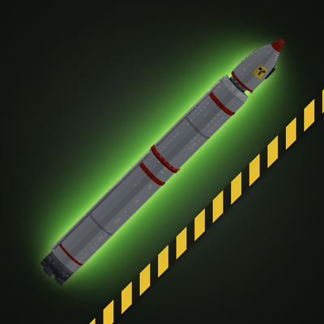
</p>

<h1 align="center">Ground Burst</h1>

<p align="center">
  <b>Assemble it. Launch it. Watch the horizon.</b><br>
  A Minecraft mod for NeoForge 26.3, 26.1.2 and 1.21.1 ·
  <a href="https://www.curseforge.com/minecraft/mc-mods/ground-burst">Download on CurseForge</a>
</p>

<p align="center">
  <a href="https://discord.gg/UZd6Sk5mzB"></a>
</p>

Mine, refine and assemble your own arsenal, from grenades, mines and mortars to missiles and the Tsar Bomba, then
watch real craters, mushroom clouds and radioactive fallout reshape the world.

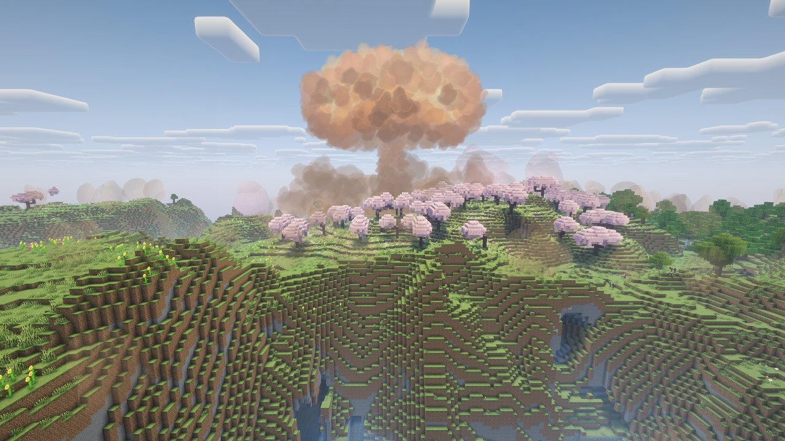

## What's in it

- **Explosives:** grenades, Molotov cocktails, placed charges with a remote detonator, landmines, bouncing mines and
  claymores.
- **At sea:** the classic horned sea mine, moored on its chain to the bottom or set adrift, and depth charges set to
  fire at a depth. Charges under water throw up towering columns of spray instead of blowing holes in the sea.
- **Artillery:** an 81 mm mortar and a towed 155 mm howitzer that reaches 600 blocks, both crewed and aimed from a
  strategic view over the battlefield, as artillery is aimed in *World of Tanks*: an aiming circle on the ground that
  blooms as the gun fires and turns and settles as you wait. HE, smoke, incendiary, chemical, cryo and EMP shells for the
  mortar; HE and incendiary for the howitzer.
- **24 warheads and the missiles to carry them**, assembled from parts and launched from silos, a launch complex, a
  cruise missile launcher and a Vertical Launch Battery sunk into the ground that ripples sixteen missiles out of its
  cells onto one area. Missiles fly for real, with staging and re-entry, and a radar array tracks them.
- **A Laser Designator** to call fire onto a target from up to 1,024 blocks away: arm and launch from its sight, and
  laser-guided missiles follow your beam all the way in, onto a moving target or another one.
- **Exotic weapons**, built whole into intercontinental missiles at the Special Weapons Assembler: an antimatter sphere
  that erases everything in it, a black hole that feeds and then implodes, a supercell storm over a whole region, and a
  deep freeze: a wall of frozen air rolling over the land, spires of ice at its heart and a cold snap after.
- **A Launch Control Station** that networks your launchers across the whole world: link them with Launch Codes,
  aim them on a map of the dimension, fire salvos in patterns or timed to land together, and launchers far away
  wake up to fire.
- **Anti-missile defence:** an Interceptor Battery and the multiblock Interceptor Complex, which shoot down incoming
  missiles, guided by a Radar Array.
- **An alarm system for your base:** a missile warning receiver that listens to the radar, air-raid sirens with
  turning horns, klaxons, bells, rotating beacons, emergency lights, alert displays and wireless redstone relays, linked
  over alarm channels.
- **Nuclear weapons and their aftermath:** mushroom clouds, craters, fallout drifting with the wind, radiation you can
  measure, hazmat suits, and a wasteland biome over the scorched ground.
- **Healing, if you want it** (off by default): turn it on in the server config and the damage grows back over time,
  block for block as it was: chests with their contents, machines with their settings, cables and pipes that carry
  again, other mods' blocks too, at a speed and on a schedule you choose. Creepers' and TNT's holes and other mods'
  explosions heal too, if you like. For forever worlds that still want their wars.
- **Industry and power:** new ores, processing machines on FE power with upgrade chips for speed and efficiency, and
  multiblock fission, fusion and singularity reactors.
- **Chips made the hard way:** silicon purified and grown into crystals in a Crystal Puller, sapphire for
  military-grade chips, and microchips printed in a Clean Room. Every advanced, military and quantum circuit waits on
  the chain, and assemblers with Auto Assemble keep a piped production line building.
- **Superweapons** in homage to *Command & Conquer: Generals – Zero Hour*: the SCUD Storm, the Nuclear Missile Silo
  and the Particle Uplink Cannon. Call any of them down with a Laser Designator, and steer the cannon's beam across the
  ground with it.
- **Seven abandoned Cold War sites** to explore, with loot:
  - a Titan II missile silo, sometimes flooded or caved in;
  - a command bunker under an earth berm;
  - a radar outpost on high ground;
  - a nuclear test site in the desert, with its shot tower, Doom Town and an earlier test's crater;
  - a crashed missile at the end of its furrow, beside the recovery team's abandoned camp;
  - a waste repository deep in a bed of salt;
  - a research station floating over the End's islands, blown open from within.
- **Construction blocks** for building your own: chain-link fencing, barbed wire, corrugated steel, steel panels,
  grating, I-beams, lattice frames, radome panels, floodlights, sandbags and warning signs. Plus two showpieces: a
  Large Silo Door whose leaves slide apart on a redstone signal, and a Search Radar that turns.
- **Shader packs:** fireballs, smoke and mushroom clouds draw right with Iris shader packs and look the same in every
  pack (tried with Bliss, Complementary Reimagined and Unbound, BSL, Photon, Solas and MakeUp Ultra Fast), and stand
  in front of Distant Horizons' far terrain, on Minecraft 26.3 and 1.21.1.
- **The Field Manual**, an in-game guide to all of it.

What changed in each version is in the [changelog](CHANGELOG.md).

## Screenshots

<table>
  <tr>
    <td>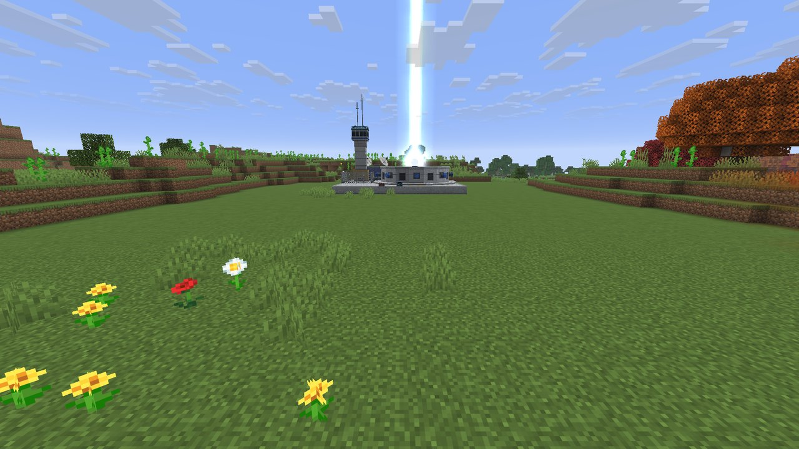<br>The Particle Uplink Cannon fires</td>
    <td>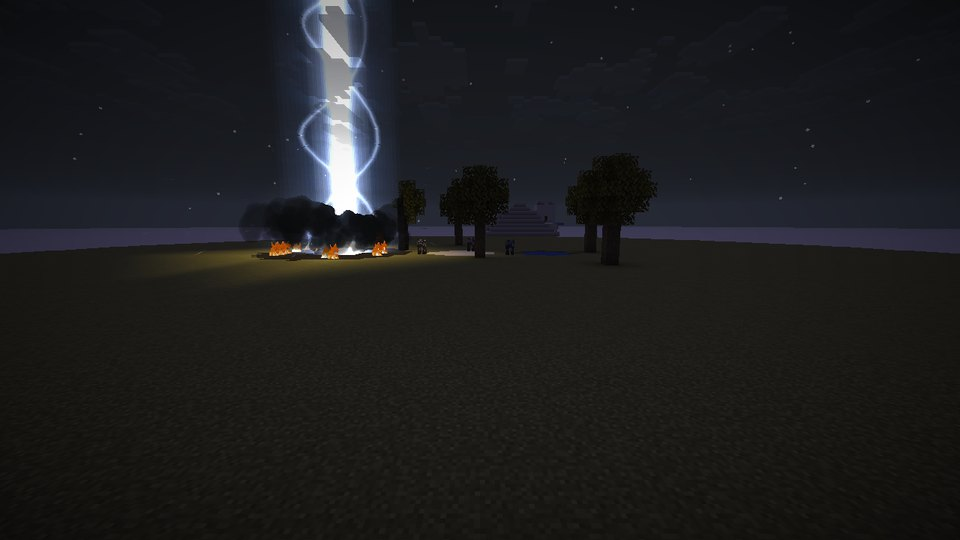<br>The particle beam, steered across a meadow at night</td>
  </tr>
  <tr>
    <td>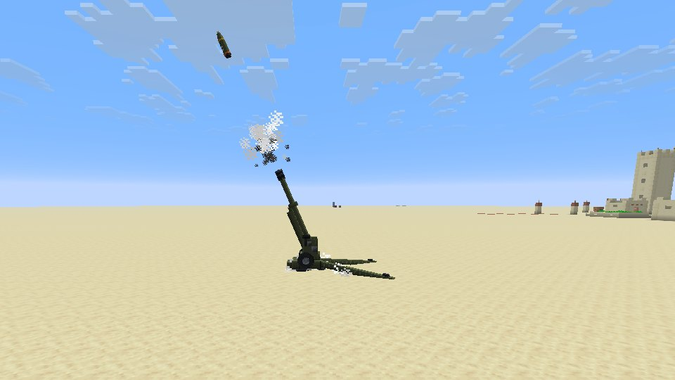<br>The 155 mm Howitzer fires</td>
    <td>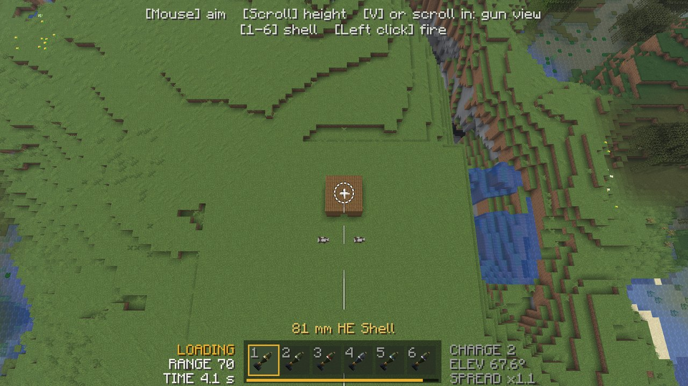<br>The mortar's strategic view: a shell lands on target</td>
  </tr>
  <tr>
    <td>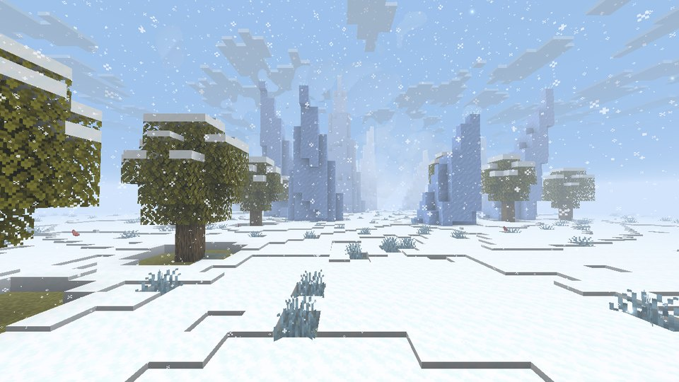<br>Spires of ice after a Cryo ICBM</td>
    <td>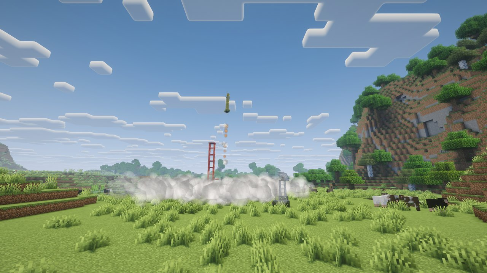<br>Lift-off from a Launch Silo</td>
  </tr>
  <tr>
    <td>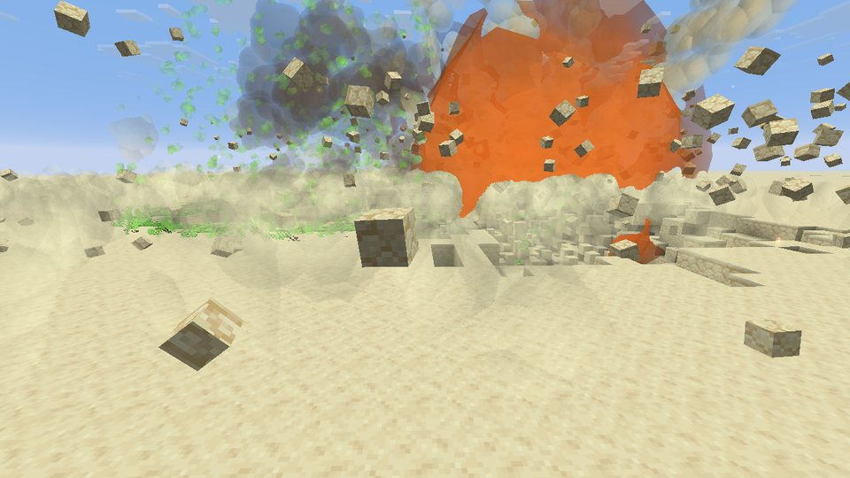<br>The SCUD Storm strikes</td>
    <td>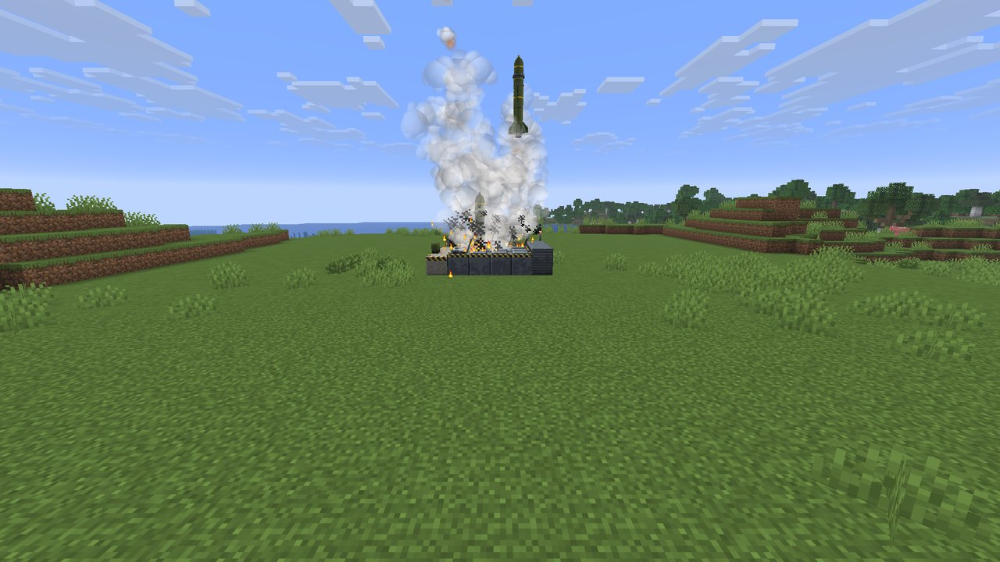<br>The Vertical Launch Battery's ripple</td>
  </tr>
  <tr>
    <td>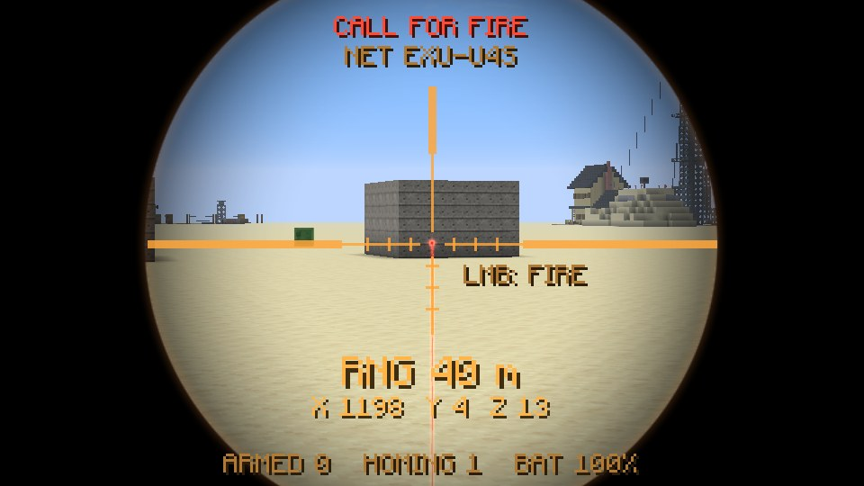<br>Calling fire with the Laser Designator</td>
    <td>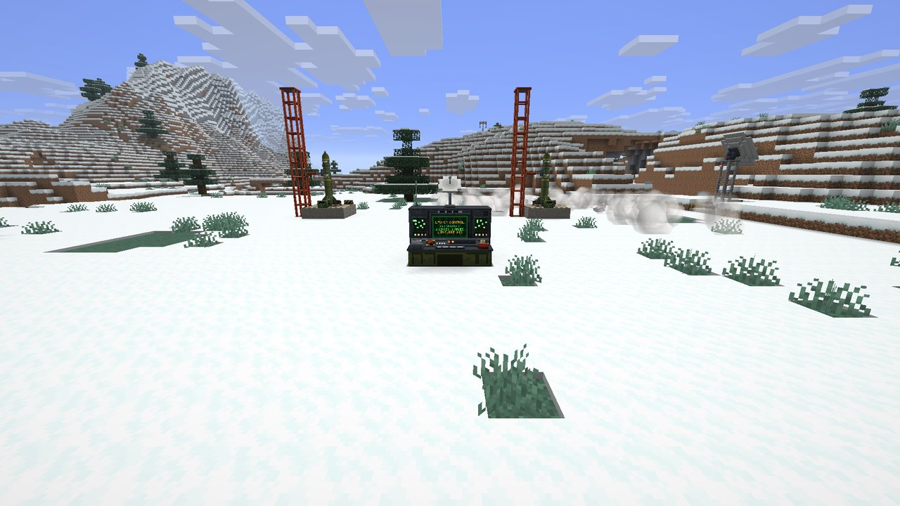<br>The Launch Control Station</td>
  </tr>
  <tr>
    <td>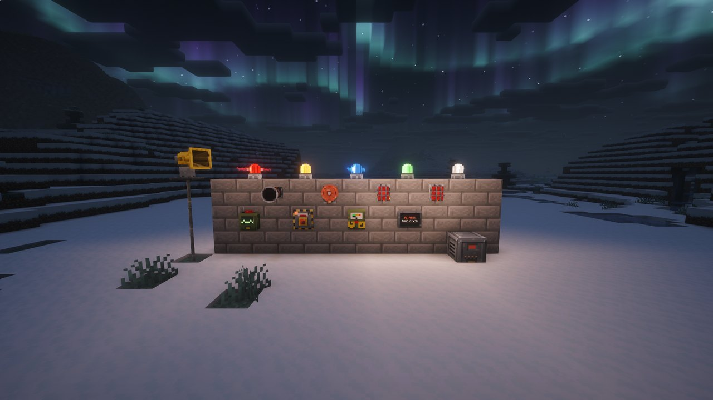<br>The alarm system at night</td>
    <td>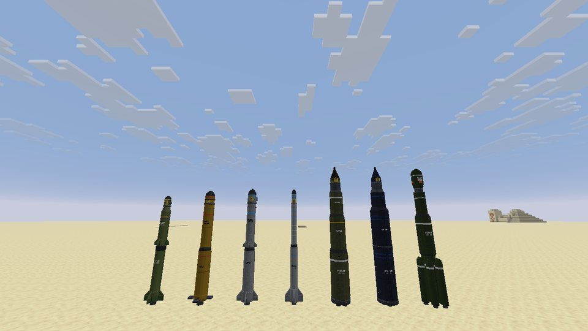<br>The nuclear missiles, from tactical to Tsar</td>
  </tr>
  <tr>
    <td>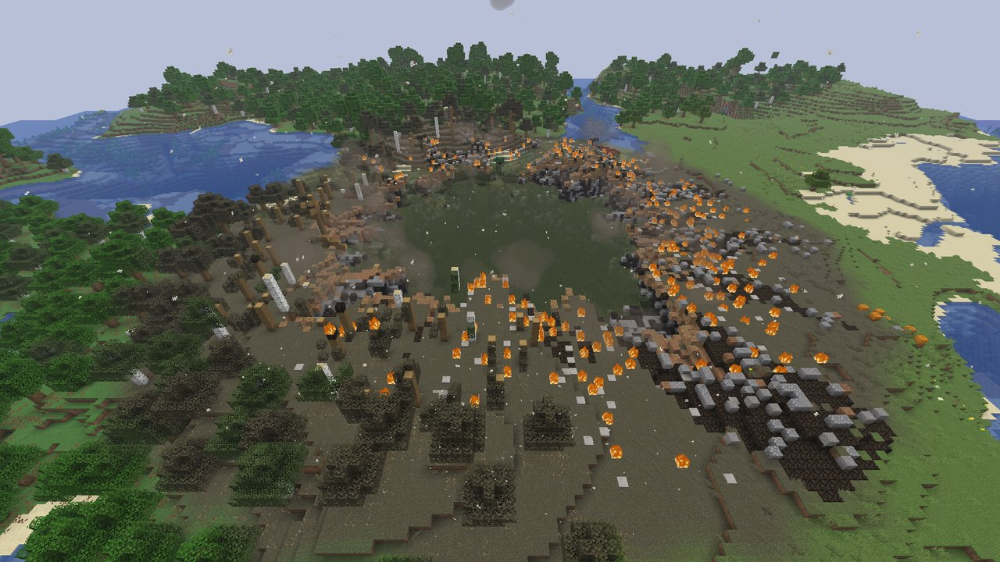<br>A tactical nuclear warhead's crater</td>
    <td>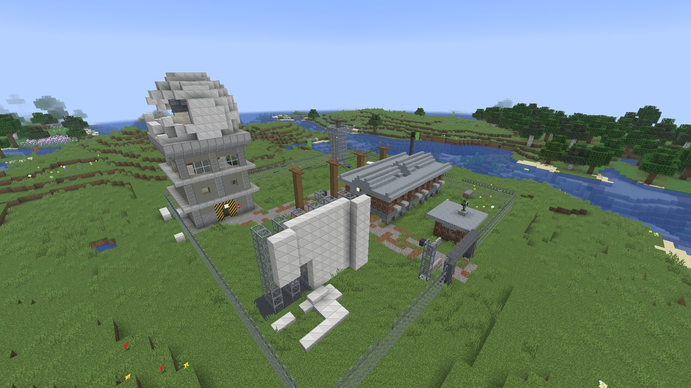<br>A Radar Outpost</td>
  </tr>
  <tr>
    <td>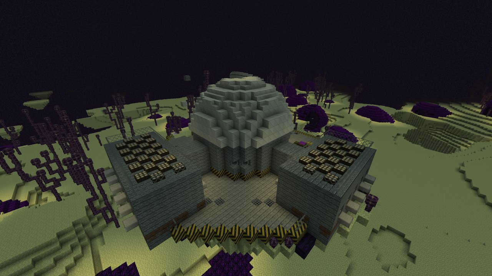<br>The Exotic Research Station</td>
    <td>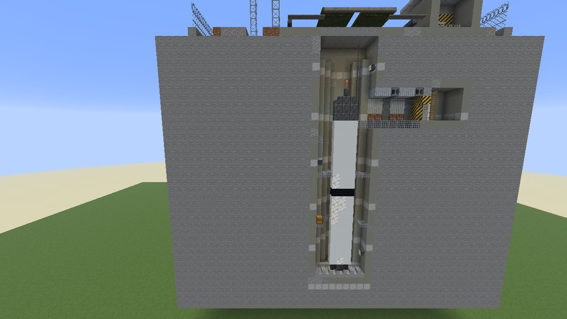<br>An abandoned silo, cut away</td>
  </tr>
  <tr>
    <td>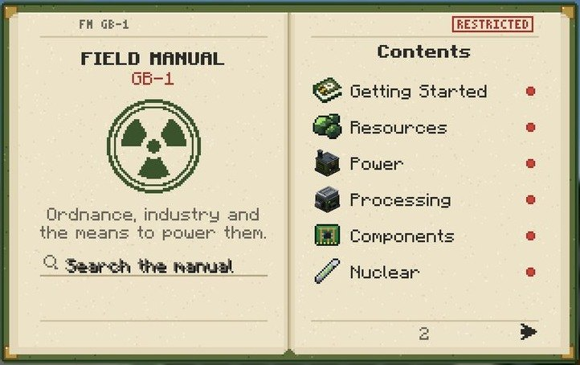<br>The Field Manual</td>
  </tr>
</table>

## Settings

Ground Burst can be tuned to your world: how big blasts are and how much they may destroy (or that they destroy
nothing at all), radiation and fallout, missile range, the superweapons, your own effects (flash, camera shake, quality),
and **healing**, which makes the damage grow back over time. Healing is **off** until you turn it on.

**In game:** open **Mods**, choose **Ground Burst**, then **Config**. Hover over any setting to see what it does.
- Minecraft 26.3: the world settings are under **Synced Settings**. Change them from the title screen or in a
  single-player world.
- Minecraft 26.1.2 and 1.21.1: the world settings are under **Server Settings**. Open a single-player world, press
  Esc, then **Mods**, **Ground Burst**, **Config**.
- On a multiplayer server, a player can't change the world settings: the server's owner edits its file (below).

**In the file:** open the `config` folder inside your Minecraft folder (on a server, inside the server's folder) and
edit one of these in any text editor. Every setting has a note above it saying what it does.
- `groundburst-synced.toml` (26.3) or `groundburst-server.toml` (26.1.2 and 1.21.1): the world settings, healing among
  them
- `groundburst-client.toml`: your own effects and the HUD

Save the file, then start the game (or the server) again.

**Healing in short:** under `[healing]`, set `enabled = true` (in game: **Healing**, then **Heal damage over time**). By
default an area starts to grow back 5 minutes after the last blast near it and takes at most 5 minutes to heal, with
everything just as it was: chests and their contents, machines and their settings, cables and pipes working again, other
mods' blocks too. You can change when it heals (after a wait, every morning, or
only when an operator says), how fast and in what order, which weapons, blocks and dimensions heal, and what happens to
blocks players have built in a crater. The game's own explosions heal too (creepers, TNT, end crystals, ghasts'
fireballs, the Wither, beds and respawn anchors), and other mods' explosions that use the game's explosion code, each
with a switch under **Other explosions**. Operators also have `/groundburst heal now`, `/groundburst heal forget` and
`/groundburst heal status`. Only damage done while healing is on comes back, so turn it on before the war starts.

## Requirements

Ground Burst comes in three files, one for each version of Minecraft; take the one for yours:

- **Minecraft 26.3**: NeoForge 26.3.0.92 or newer, and [GeckoLib](https://www.curseforge.com/minecraft/mc-mods/geckolib)
  5.5.7 or newer (required)
- **Minecraft 26.1.2**: NeoForge 26.1.2.126 or newer, and [GeckoLib](https://www.curseforge.com/minecraft/mc-mods/geckolib)
  5.5.2 or newer (required). The recipes that use Minecraft 26.2's sulfur and cinnabar are not in it.
- **Minecraft 1.21.1**: NeoForge 21.1.265 or newer, and [GeckoLib](https://www.curseforge.com/minecraft/mc-mods/geckolib)
  4.9.3 or newer (required). A few things are simpler on it: Rad-Away, Potassium Iodide Tablets and the Anti-Rad
  Injector are used as food is (with no nourishment), the pointer stays an arrow over the mod's screens, and flash
  particles are not tinted.
- [JEI](https://www.curseforge.com/minecraft/mc-mods/jei) (optional) on any
- [Iris](https://www.curseforge.com/minecraft/mc-mods/irisshaders) (optional) on 26.3 and 1.21.1, for shader packs
- [Distant Horizons](https://www.curseforge.com/minecraft/mc-mods/distant-horizons) (optional) on 26.3 and 1.21.1:
  blast effects stand in front of its far terrain

Install it on the server and on every player's game: it adds blocks and items, so both sides need it.

## Making add-ons

Ground Burst is MIT-licensed, so add-ons are welcome. Some starting points:

- **Blasts** are data: each one is a blast profile in a datapack registry
  (`data/<namespace>/groundburst/blast_profile/<name>.json`; the mod's own are in
  `src/generated/resources/data/groundburst/groundburst/blast_profile/`). In code, `Blasts.detonate(...)` in
  `dev.groundburst.blast` sets one off.
- **Radioactivity** of items and blocks is a data map: `data/groundburst/data_maps/item/radioactivity.json` and
  `data/groundburst/data_maps/block/radioactivity.json` (see `GBRadiation`).
- **World sites** use the `groundburst:site` structure type (`dev.groundburst.world.structure`), so new sites can be
  added as structure JSON and templates; the mod's own are generated by `tools/structure/sites.py`.
- The design document, [`docs/DESIGN.md`](docs/DESIGN.md), describes every system and its numbers.

## Building from source

You need JDK 25. Then:

```
./gradlew build
```

The jar lands in `build/libs/`. Other useful tasks: `runClient` (a development client), `runGameTestServer` (the
GameTests) and `runData` (data generation). The 1.21.1 build is made from the `1.21.1` branch with JDK 21, and the
26.1.2 build from the `26.1.2` branch; each branch's `docs/BACKPORT.md`
([1.21.1](https://github.com/Lawman-afk/GroundBurstMCMod/blob/1.21.1/docs/BACKPORT.md),
[26.1.2](https://github.com/Lawman-afk/GroundBurstMCMod/blob/26.1.2/docs/BACKPORT.md)) says how. The models, textures and sounds are generated by the Python scripts in
`tools/` (set up a virtual environment with `pip install -r tools/requirements.txt`).

## Licence

The mod is released under the [MIT licence](LICENSE).

Some of its sounds are made from recordings shared on [Freesound](https://freesound.org) under CC0 1.0 and CC BY 4.0.
Those recordings keep their own licences: each one is credited, with its author, source and licence, in
[`CREDITS.txt`](src/main/resources/assets/groundburst/sounds/CREDITS.txt).

## Credits

- [GeckoLib](https://github.com/bernie-g/geckolib) for the animated models, and [JEI](https://github.com/mezz/JustEnoughItems)
  for recipe lookup.
- The superweapons are a homage to *Command & Conquer: Generals – Zero Hour*. Ground Burst is not affiliated with
  Electronic Arts.
- The recordists credited in [`CREDITS.txt`](src/main/resources/assets/groundburst/sounds/CREDITS.txt).
