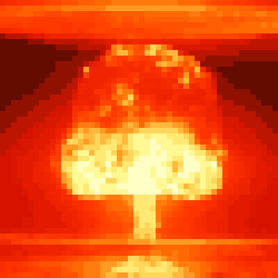
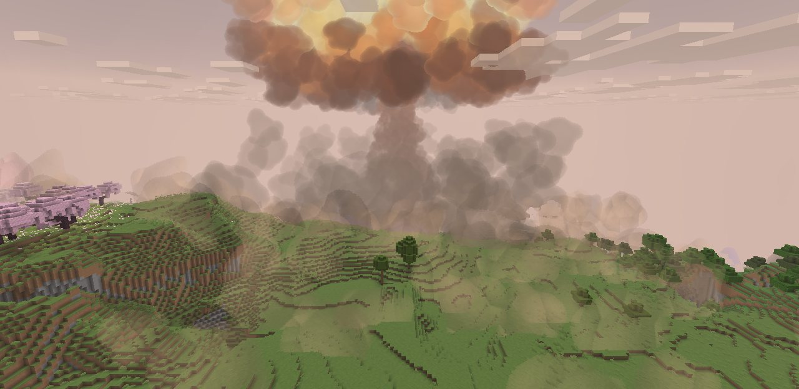
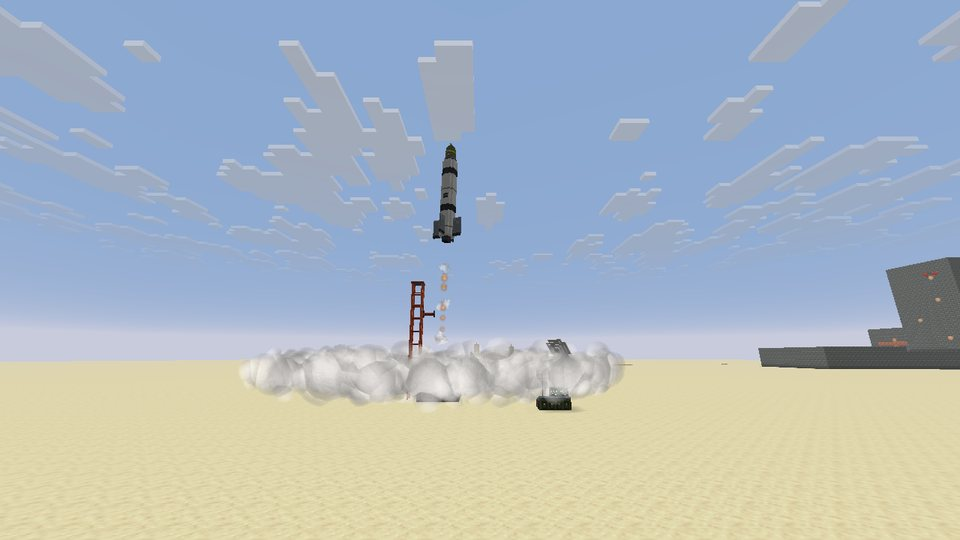
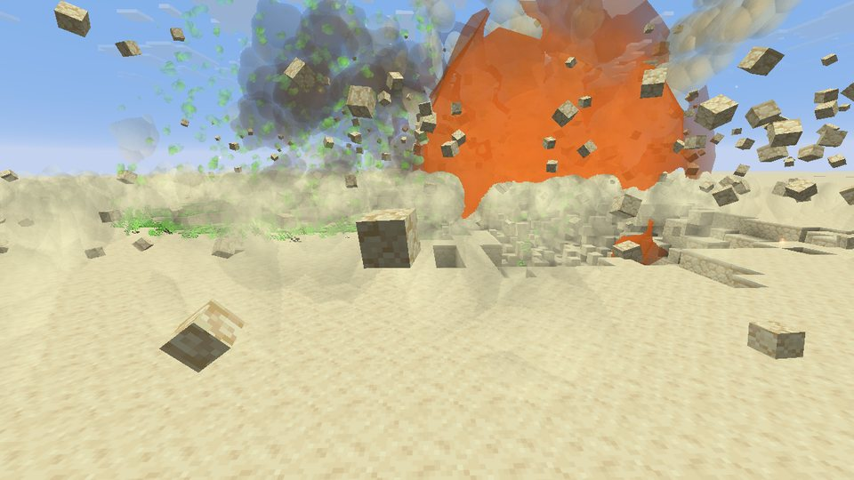
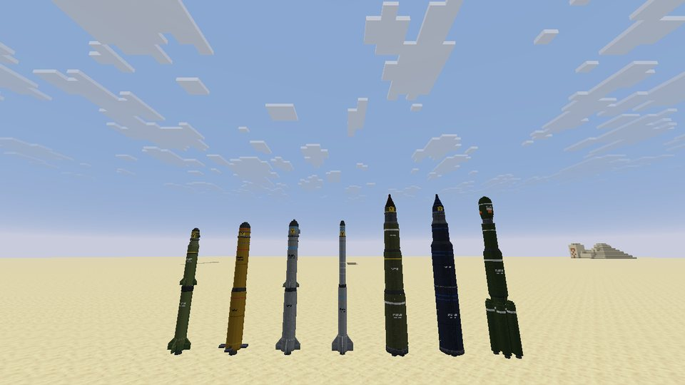
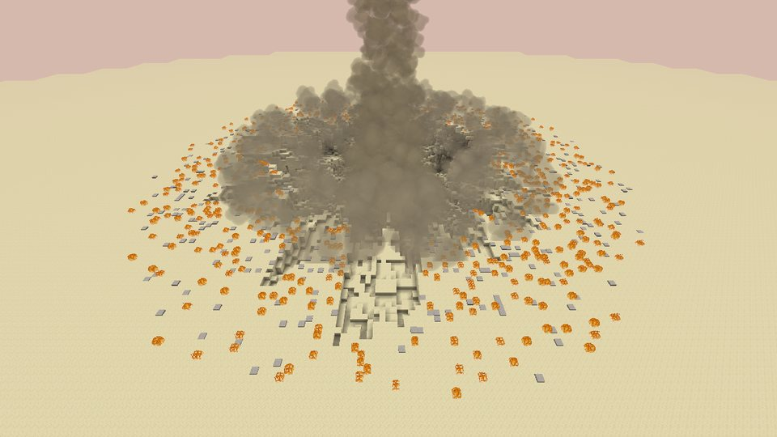
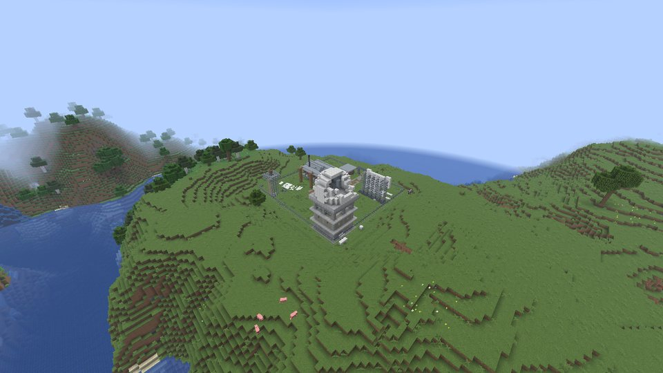
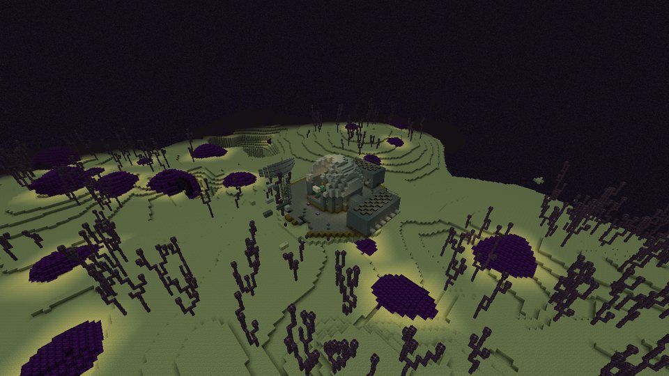
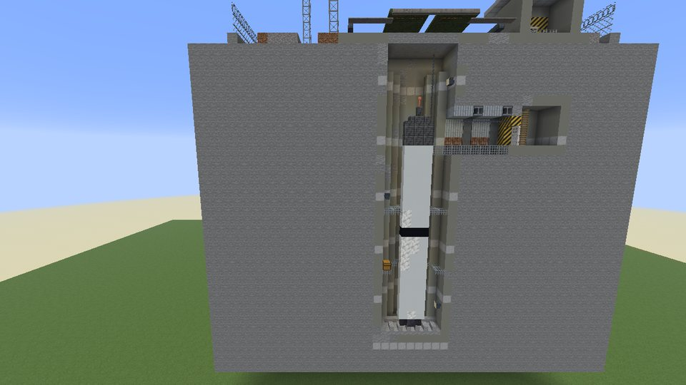
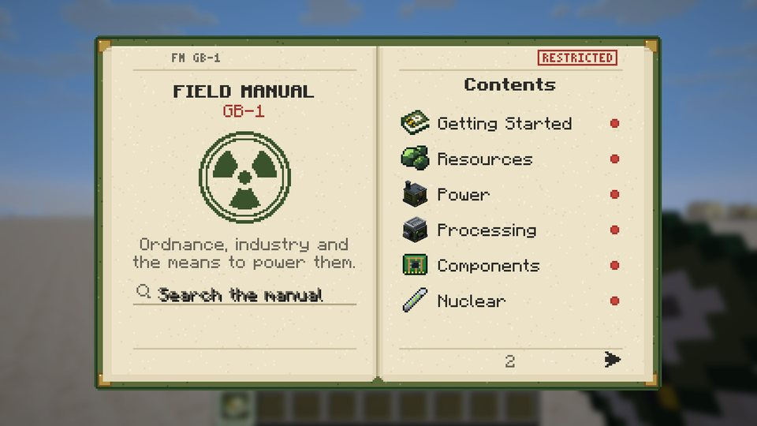

<p align="center">
  
</p>

<h1 align="center">Ground Burst</h1>

<p align="center">
  <b>Assemble it. Launch it. Watch the horizon.</b><br>
  A Minecraft mod for NeoForge 26.3 ·
  <a href="https://www.curseforge.com/minecraft/mc-mods/ground-burst">Download on CurseForge</a>
</p>

Mine, refine and assemble your own arsenal, from grenades and mines to missiles and the Tsar Bomba, then watch real
craters, mushroom clouds and radioactive fallout reshape the world.



## What's in it

- **Explosives:** grenades, Molotov cocktails, placed charges with a remote detonator, landmines, bouncing mines and
  claymores.
- **21 warheads and the missiles to carry them**, assembled from parts and launched from silos, a launch complex and
  a cruise missile launcher. Missiles fly for real, with staging and re-entry, and a radar array tracks them.
- **Nuclear weapons and their aftermath:** mushroom clouds, craters, fallout drifting with the wind, radiation you can
  measure, hazmat suits, and a wasteland biome over the scorched ground.
- **Industry and power:** new ores, processing machines on FE power, and multiblock fission, fusion and singularity
  reactors.
- **Superweapons** in homage to *Command & Conquer: Generals – Zero Hour*: the SCUD Storm and the Nuclear Missile Silo.
- **Seven abandoned Cold War sites** to explore, with loot:
  - a Titan II missile silo, sometimes flooded or caved in;
  - a command bunker under an earth berm;
  - a radar outpost on high ground;
  - a nuclear test site in the desert, with its shot tower, Doom Town and an earlier test's crater;
  - a crashed missile at the end of its furrow, beside the recovery team's abandoned camp;
  - a waste repository deep in a bed of salt;
  - a research station floating over the End's islands, blown open from within.
- **Construction blocks** for building your own: chain-link fencing, barbed wire, corrugated steel, steel panels,
  grating, I-beams, lattice frames, radome panels, floodlights, sandbags and warning signs. Plus two showpieces: a
  Large Silo Door whose leaves slide apart on a redstone signal, and a Search Radar that turns.
- **The Field Manual**, an in-game guide to all of it.

What changed in each version is in the [changelog](CHANGELOG.md).

## Screenshots

<table>
  <tr>
    <td><br>Lift-off from a Launch Silo</td>
    <td><br>The SCUD Storm strikes</td>
  </tr>
  <tr>
    <td><br>The nuclear missiles, from tactical to Tsar</td>
    <td><br>A tactical nuclear warhead's crater</td>
  </tr>
  <tr>
    <td><br>A Radar Outpost</td>
    <td><br>The Exotic Research Station</td>
  </tr>
  <tr>
    <td><br>An abandoned silo, cut away</td>
    <td><br>The Field Manual</td>
  </tr>
</table>

## Requirements

- Minecraft 26.3 with NeoForge 26.3.0.92 or newer
- [GeckoLib](https://www.curseforge.com/minecraft/mc-mods/geckolib) 5.5.7 or newer (required)
- [JEI](https://www.curseforge.com/minecraft/mc-mods/jei) (optional)

Install it on the server and on every player's game: it adds blocks and items, so both sides need it.

## Making add-ons

Ground Burst is MIT-licensed, so add-ons are welcome. Some starting points:

- **Blasts** are data: each one is a blast profile in a datapack registry
  (`data/<namespace>/groundburst/blast_profile/<name>.json`; the mod's own are in
  `src/generated/resources/data/groundburst/groundburst/blast_profile/`). In code, `Blasts.detonate(...)` in
  `dev.groundburst.blast` sets one off.
- **Radioactivity** of items and blocks is a data map: `data/groundburst/data_maps/item/radioactivity.json` and
  `data/groundburst/data_maps/block/radioactivity.json` (see `GBRadiation`).
- **World sites** use the `groundburst:site` structure type (`dev.groundburst.world.structure`), so new sites can be
  added as structure JSON and templates; the mod's own are generated by `tools/structure/sites.py`.
- The design document, [`docs/DESIGN.md`](docs/DESIGN.md), describes every system and its numbers.

## Building from source

You need JDK 25. Then:

```
./gradlew build
```

The jar lands in `build/libs/`. Other useful tasks: `runClient` (a development client), `runGameTestServer` (the
GameTests) and `runData` (data generation). The models, textures and sounds are generated by the Python scripts in
`tools/` (set up a virtual environment with `pip install -r tools/requirements.txt`).

## Licence

The mod is released under the [MIT licence](LICENSE).

Some of its sounds are made from recordings shared on [Freesound](https://freesound.org) under CC0 1.0 and CC BY 4.0.
Those recordings keep their own licences: each one is credited, with its author, source and licence, in
[`CREDITS.txt`](src/main/resources/assets/groundburst/sounds/CREDITS.txt).

## Credits

- [GeckoLib](https://github.com/bernie-g/geckolib) for the animated models, and [JEI](https://github.com/mezz/JustEnoughItems)
  for recipe lookup.
- The superweapons are a homage to *Command & Conquer: Generals – Zero Hour*. Ground Burst is not affiliated with
  Electronic Arts.
- The recordists credited in [`CREDITS.txt`](src/main/resources/assets/groundburst/sounds/CREDITS.txt).
