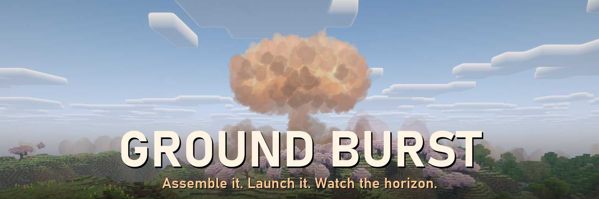
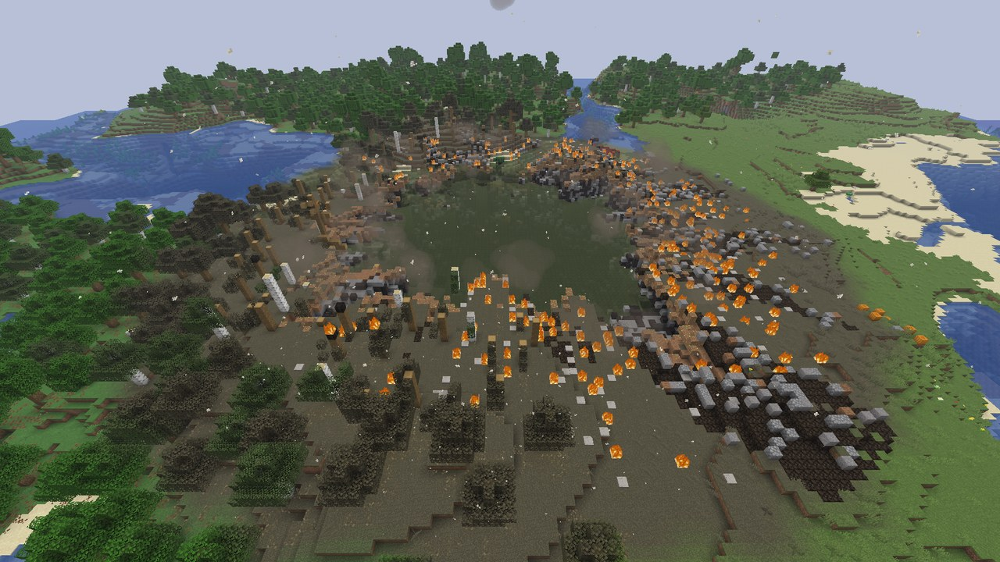
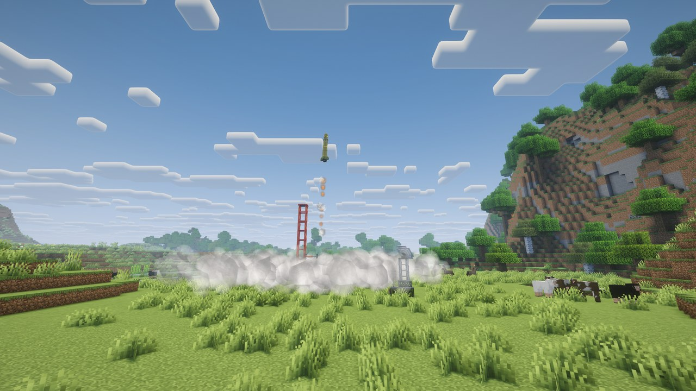
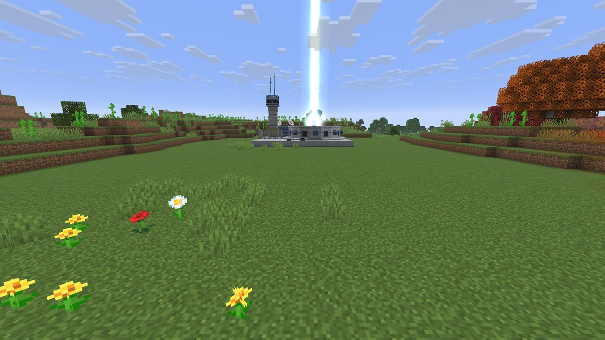
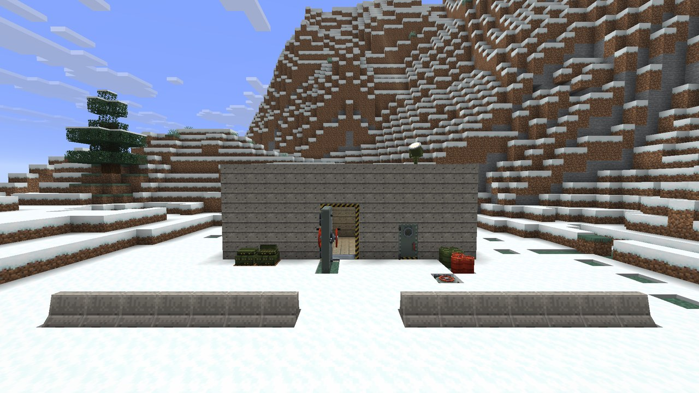
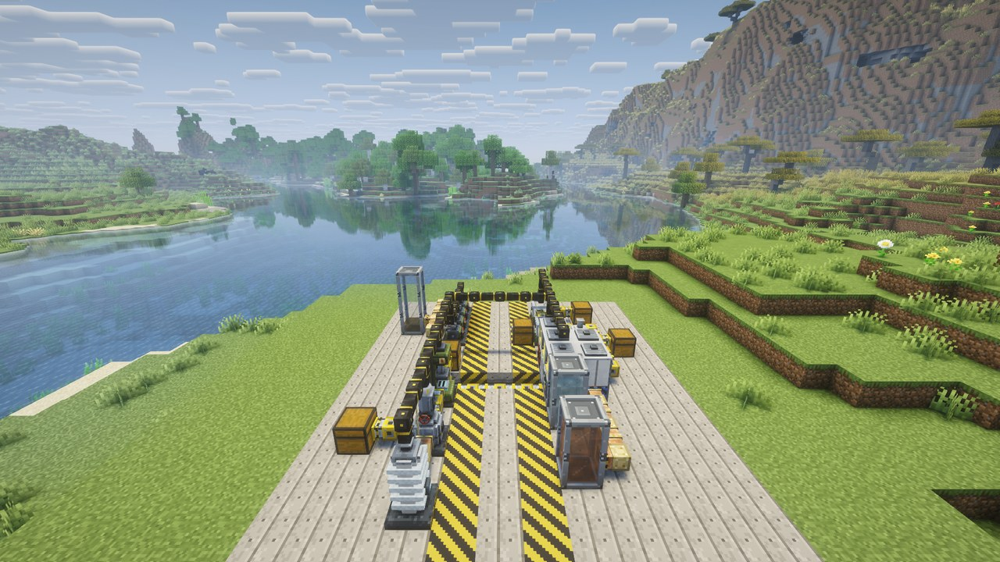
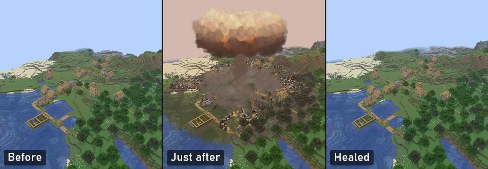

**Assemble it. Launch it. Watch the horizon.**

Build your own arsenal from raw ore, from grenades and landmines to ICBMs and the Tsar Bomba, then watch real mushroom
clouds, craters and radioactive fallout reshape your world. Hold your ground with radar, interceptors and a bunker of
your own.

**NeoForge** · Minecraft **26.3**, **26.1.2** and **1.21.1** · singleplayer and servers · shader packs, Distant Horizons
and JEI · Create on 1.21.1

## Nuclear blasts that change the land

A flash, a shock front and a mushroom cloud you can see for miles; then a crater cut into the terrain, fires, and
fallout that drifts with the wind. Measure the radiation with a Geiger counter, put on a hazmat suit, and watch a
wasteland spread over the scorched ground.

## Missiles that really fly

Assemble a missile part by part, pick one of 24 warheads and launch it from a silo, a launch complex or a cruise
launcher. It climbs, stages, re-enters and lands where you aimed, up to 30,000 blocks away. Radar tracks it, and
interceptors can shoot it down.

## Superweapons

The SCUD Storm, the Nuclear Missile Silo and the Particle Uplink Cannon, a homage to *Command & Conquer: Generals – Zero
Hour*. Call them down with a Laser Designator and steer the cannon's beam across the ground. Or build something
stranger: antimatter, a black hole, a supercell storm or a deep freeze.

## A base worth defending

Blast doors whose handwheel draws the bolts, hatches with a ladder built in, a command room with consoles and tape
computers, air-raid sirens, searchlights, Jersey barriers and dragon's teeth. One Launch Control Station aims every
launcher you own, anywhere in the world.

## Industry from the ground up

Mine uranium and refine it in gas centrifuges, grow silicon crystals and print microchips in a Clean Room. Fission,
fusion and singularity reactors power the machines that build your arsenal, and Auto Assemble keeps a production line
running.

## Healing for forever worlds

Turn healing on and the damage grows back over time, block for block as it was: chests with their contents, machines
with their settings, other mods' blocks too. Creepers' and TNT's holes can heal as well. War, without wrecking the map
for good.

## Everything in it

- **Explosives:** grenades, Molotov cocktails, placed charges with a remote detonator, landmines, bouncing mines and
  claymores.
- **24 warheads**, from high explosive, napalm and cluster to neutron, cobalt and the Tsar Bomba, and the missiles to
  carry them.
- **Launchers:** launch silos, a launch complex, a cruise missile launcher and a Vertical Launch Battery that ripples
  sixteen missiles onto one area.
- **A Launch Control Station** that networks every launcher you own: aim on a map of the world, fire salvos timed to
  land together.
- **A Laser Designator** to call fire from up to 1,024 blocks away; laser-guided missiles follow your beam.
- **Artillery:** an 81 mm mortar and a 155 mm howitzer, aimed from a strategic view over the battlefield.
- **At sea:** horned sea mines, moored or adrift, and depth charges thrown or rolled off a stern rack.
- **Exotic weapons:** antimatter, a black hole, a supercell storm and a deep freeze, built whole into ICBMs.
- **Superweapons:** the SCUD Storm, the Nuclear Missile Silo and the Particle Uplink Cannon.
- **Defence:** a Radar Array, an Interceptor Battery and the Interceptor Complex; a missile warning receiver, air-raid
  sirens, klaxons, bells and rotating beacons.
- **The aftermath:** craters, fallout, radiation, Geiger counters, hazmat suits and a wasteland biome.
- **Industry and power:** new ores, processing machines with upgrade chips, fission, fusion and singularity reactors,
  and a chip chain from raw silicon to quantum circuits.
- **Seven abandoned Cold War sites** to explore, with loot: a Titan II missile silo, a command bunker, a radar outpost,
  a nuclear test site, a crashed missile, a waste repository deep in salt and a research station over the End.
- **Building blocks:** bunker doors and hatches, a command room, bunker fittings, barriers and drums for the yard,
  chain-link fencing, barbed wire, sandbags, warning signs, a Large Silo Door and a Search Radar that turns.
- **Healing**, off until you turn it on, with full control over when, how fast and what grows back.
- **The Field Manual**, an in-game guide to all of it.

More pictures in the **Images** tab.

## Built with its players

Ideas from the comments and the Discord ship quickly: healing for vanilla explosions and shader-pack support both came
from players' requests. Tell us what you want next.

## Getting started

1. Install NeoForge and GeckoLib for your Minecraft version, then Ground Burst, on the server and on every player's
   game.
2. Every player gets the **Field Manual** the first time they join (or craft one from a book and gunpowder). It shows
   every block, item and machine, how to build it and what it does.
3. With JEI installed, press R on any item to see how it is made.

## For servers

- Big blasts are worked through a little each tick, so the server keeps running through a nuke.
- Settings for how big blasts are and what they may destroy (or nothing at all), radiation, fallout, missile range and
  the superweapons.
- Healing puts a war-torn map back the way it was, on the schedule you choose.

## Works with

- **Shader packs (Iris):** fireballs, smoke and mushroom clouds draw right and look the same in every pack (tried with
  Bliss, Complementary Reimagined and Unbound, BSL, Photon, Solas and MakeUp Ultra Fast). On 26.3 and 1.21.1.
- **Distant Horizons:** blast effects stand in front of its far terrain. On 26.3 and 1.21.1.
- **JEI:** every recipe, every machine.
- **Create and Create Aeronautics** (Minecraft 1.21.1, optional): launchers on trains, bearings and airships, every
  machine working on moving contraptions and ships, and weapons that hit them.

**Create and Create Aeronautics in detail**

- **Every machine rides along:** Create's moving contraptions (trains, mechanical bearings, pistons, gantries, pulleys
  and minecart contraptions) carry launchers, missile assemblers, Launch Computers, Launch Control Stations, Radar
  Arrays, generators, capacitor banks and the processing machines. Glue or attach any part of a formed structure and the
  whole of it moves. Carried, a machine keeps working: an assembler goes on building its missile, a generator burns its
  fuel.
- **Menus on the move:** right-click a carried machine, or any block of a carried structure, to open its menu, or its
  screen for a Launch Computer, Control Station or Radar Array.
- **Power and pipes aboard:** a contraption's generators and capacitor banks power every machine on it, no cables
  needed, each getting a fair share. Item and fluid pipes on it keep working, moving things between its machines, the
  launchers' Item Ports and Create's chests, vaults and tanks.
- **Launchers on the move:** aim, arm and fire one as always from a Launch Computer, a Launch Control Station or a Laser
  Designator. It counts down and launches from wherever the contraption or ship has it, its missiles heading the way it
  points. Set down again, a structure forms where it lands and stays on its network. Missile launchers, superweapons and
  both interceptor launchers all work this way.
- **Create Aeronautics ships, planes, cars and boats:** a launcher aboard works as it does on the ground, and a Launch
  Computer, Control Station or Radar Array aboard a ship works there too, seeing the world from where the ship has
  taken it.
- **Weapons hit ships and contraptions:** a warhead's, shell's, bomb's or charge's blast breaks their blocks in its
  reach, just as it breaks the world's (dense blocks still shield what is behind them), and shoves ships away, turning
  them by the side that faced it. What a blast sees of a ship is scorched and may catch fire. Missiles and shells hit
  ships and contraptions in their way instead of passing through, and a chest or machine blown off one goes with what it
  held.
- **The special weapons too:** the Particle Uplink Cannon's beam burns down through ships and contraptions under it, the
  Cryo ICBM's freeze ices them over, a singularity pulls ships in and swallows them, and antimatter erases whatever of
  them it reaches.
- **Aim at a ship:** the Laser Designator's beam lands on a ship where you see it and missiles home on it there; a mortar
  or howitzer aims at the ship, at its height.
- **Depth charges off a ship:** a Depth Charge Rack aboard a Create Aeronautics ship rolls its charges off into the sea,
  and Create's funnels load it as hoppers do.
- **Not yet:** reactors pause while carried, and pipes and cables on a contraption reach only what is on it, not the
  blocks round it.

Made and tested with Create 6.0.10, Create Aeronautics 1.3.2 and Sable 2.0.6.

## FAQ

- **Forge or Fabric?** NeoForge only.
- **Minecraft 1.20.1?** Not at the moment: 26.3, 26.1.2 and 1.21.1.
- **Will a nuke lag my game?** Big blasts are spread over many ticks, and the settings can make them smaller or keep
  them from breaking blocks at all.
- **Can I stop explosions wrecking my builds?** Yes: limit what blasts may destroy, or turn on healing.
- **Can I use it in a modpack?** Yes, freely.
- **Bedrock or Pocket Edition?** No, Java Edition only.
- **Does the server need it?** Yes, the server and every player.
- **Where do I start?** Open the Field Manual.

## Settings

Ground Burst can be tuned to your world: how big blasts are and how much they may destroy (or that they destroy
nothing at all), radiation and fallout, missile range, the superweapons, your own effects (flash, camera shake,
quality), and **healing**, which makes the damage grow back over time. Healing is **off** until you turn it on.

**How to change the settings**

**In game:** open **Mods**, choose **Ground Burst**, then **Config**. Hover over any setting to see what it does.
- Minecraft 26.3: the world settings are under **Synced Settings**. Change them from the title screen or in a
  single-player world.
- Minecraft 26.1.2 and 1.21.1: the world settings are under **Server Settings**. Open a single-player world, press
  Esc, then **Mods**, **Ground Burst**, **Config**.
- On a multiplayer server, a player can't change the world settings: the server's owner edits its file (below).

**In the file:** open the `config` folder inside your Minecraft folder (on a server, inside the server's folder) and
edit one of these in any text editor. Every setting has a note above it saying what it does.
- `groundburst-synced.toml` (26.3) or `groundburst-server.toml` (26.1.2 and 1.21.1): the world settings, healing among
  them
- `groundburst-client.toml`: your own effects and the HUD

Save the file, then start the game (or the server) again.

**Healing**

**To turn it on:** under `[healing]`, set `enabled = true` (in game: **Healing**, then **Heal damage over time**). By
default an area starts to grow back 5 minutes after the last blast near it and takes at most 5 minutes to heal, with
everything just as it was: chests and their contents, machines and their settings, cables and pipes working again, other
mods' blocks too. You can change when it heals (after a wait, every morning, or
only when an operator says), how fast and in what order, which weapons, blocks and dimensions heal, and what happens to
blocks players have built in a crater. The game's own explosions heal too (creepers, TNT, end crystals, ghasts'
fireballs, the Wither, beds and respawn anchors), and other mods' explosions that use the game's explosion code, each
with a switch under **Other explosions**. Operators also have `/groundburst heal now`, `/groundburst heal forget` and
`/groundburst heal status`. Only damage done while healing is on comes back, so turn it on before the war starts.

## Requirements

Ground Burst comes in three files, one for each version of Minecraft; take the one for yours:

- **Minecraft 26.3**: NeoForge 26.3.0.92 or newer, and **GeckoLib** 5.5.7 or newer (required)
- **Minecraft 26.1.2**: NeoForge 26.1.2.126 or newer, and **GeckoLib** 5.5.2 or newer (required). The recipes that
  use Minecraft 26.2's sulfur and cinnabar are not in it.
- **Minecraft 1.21.1**: NeoForge 21.1.265 or newer, and **GeckoLib** 4.9.3 or newer (required). A few things are
  simpler on it: Rad-Away, Potassium Iodide Tablets and the Anti-Rad Injector are used as food is (with no
  nourishment), the pointer stays an arrow over the mod's screens, and flash particles are not tinted.
- **JEI** (optional) on any
- **Iris** (optional) on 26.3 and 1.21.1, for shader packs
- **Distant Horizons** (optional) on 26.3 and 1.21.1: blast effects stand in front of its far terrain
- **Create** 6 and **Create Aeronautics** (with Sable 2) (optional, Minecraft 1.21.1 only), for the machines and weapons
  on moving structures above

Install it on the server and on every player's game: it adds blocks and items, so both sides need it.

## Modpacks

You are free to include Ground Burst in any modpack.

## Planned

- The world's Cold War sites rebuilt with the new bunker doors, command rooms and fittings
- Contamination that sticks to you and your gear, and more fallout and aftermath protection
- War room displays
- Seismographs
- A Dead Hand system
- More underwater and naval weapons
- Being considered: handheld weapons based on the special warheads

## Links

- Source code: [GitHub](https://github.com/Lawman-afk/GroundBurstMCMod)
- Found a bug? Report it on the **Issues** tab, or in the Discord.
- Questions, ideas and feedback: [join the Ground Burst Discord](https://discord.gg/UZd6Sk5mzB).
- What changed in each version: the **Changelog** of each file, or the
  [full changelog](https://github.com/Lawman-afk/GroundBurstMCMod/blob/main/CHANGELOG.md).

## Credits

- [GeckoLib](https://github.com/bernie-g/geckolib) for the animated models, and
  [JEI](https://github.com/mezz/JustEnoughItems) for recipe lookup.
- The superweapons are a homage to *Command & Conquer: Generals – Zero Hour*. Ground Burst is not affiliated with
  Electronic Arts.
- Ground Burst is released under the [MIT licence](https://github.com/Lawman-afk/GroundBurstMCMod/blob/main/LICENSE).

**Sound credits**

Some of the mod's sounds are made from recordings shared on [Freesound](https://freesound.org). Each was changed: cut,
cleaned of background noise, filtered, slowed or layered with others and with synthesized sound.

**Licensed [CC BY 4.0](https://creativecommons.org/licenses/by/4.0/):**

- "FX - Rock / stone falling debris" by bolkmar, https://freesound.org/people/bolkmar/sounds/539178/
- "BurlingtonIndustriesImplosion.wav" by the_toilet_guy, https://freesound.org/people/the_toilet_guy/sounds/98852/

**Licensed [CC0 1.0](https://creativecommons.org/publicdomain/zero/1.0/) (public domain):** recordings by aerror,
Andriejus, Breviceps, cambrianman, cognito perceptu, craigsmith, csengeri, deleted_user_7146007, dnewtonjr, dwareing, elonen,
Ev-Dawg, F3ather, frankelmedico, Garuda1982, greenbastardd, Groovy_Studio, Iamgiorgio, interkin3tic, jasonLON,
joneekemp, julujanus, Kinoton, klangfabrik, kyles, megashroom, modusmogulus, nooly, northern87, Nox_Sound, nuckan,
parabolix, pedrgloria, pyer75, qubodup, Rudmer_Rotteveel, RytmenPinnen, sevenbsb, Sheyvan, sidohzen, sirkhandijoan, SpaceJoe,
SpooksJH, squashy555, ThabzMalik, TiesWijnen, unfa and Yoyodaman234. Each recording, with its link, is listed in
[CREDITS.txt](https://github.com/Lawman-afk/GroundBurstMCMod/blob/main/src/main/resources/assets/groundburst/sounds/CREDITS.txt).
